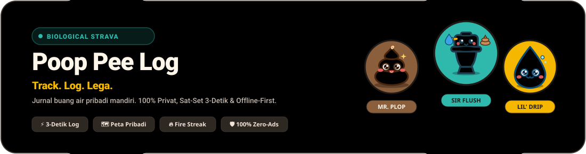
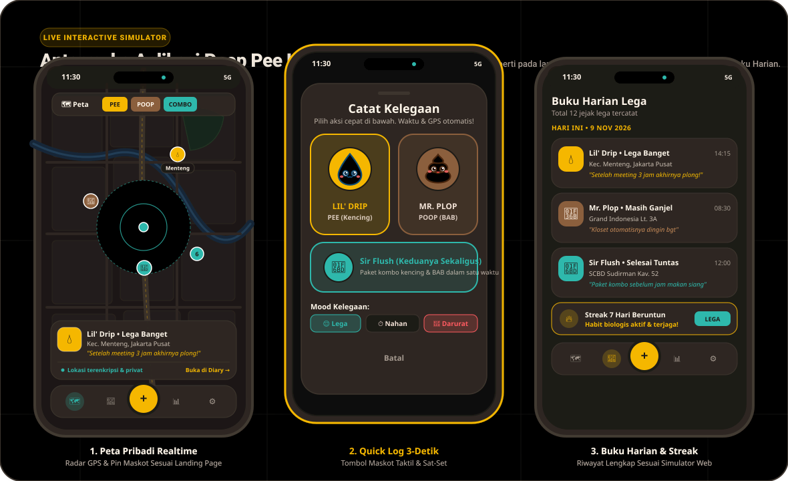

<div align="center">



# 🚽 Poop Pee Log 🧻
### *"Track. Log. Lega."*

**Aplikasi *personal biological lifelogger* buang air kecil (Pee) dan buang air besar (Poop) yang sat-set 3-detik, 100% privat, estetik, dan menyenangkan.**

[](https://opensource.org/licenses/MIT)
[](https://www.typescriptlang.org/)
[](https://react.dev/)
[](https://expo.dev/)
[](https://tailwindcss.com/)
[](https://supabase.com/)
[](https://github.com/nurmuhamadrum/pooppeelog/pulls)

[📱 Fitur Utama](#-fitur-unggulan) • [🖼️ Mockup Aplikasi](#-mockup-antarmuka-aplikasi) • [🎭 Trio Maskot](#-trio-maskot-resmi) • [🛠️ Menjalankan Proyek](#-panduan-instalasi--menjalankan-proyek) • [📚 Dokumentasi](#-indeks-dokumentasi-lengkap)

</div>

---

## 🖼️ Mockup Antarmuka Aplikasi

Berikut adalah visualisasi antarmuka aplikasi **Poop Pee Log** (Mobile App) yang mengusung tema *Warm Dark Canvas* (`#1E1A17`), kontras ramah mata, dan aksen warna maskot resmi:

<div align="center">
  
</div>

<br/>

| 🗺️ **1. Peta Pribadi Realtime** | ⚡ **2. Quick Log 3-Detik** | 🏆 **3. Habit & Gamifikasi** |
| :--- | :--- | :--- |
| • Radar GPS aktif dengan radius dinamis (15m – 100m).<br/>• Pin maskot **Mr. Plop** (Poop) & **Lil' Drip** (Pee).<br/>• Pilihan tema peta: *Dark Mode*, *Vintage Cream*, dan *OS Standard*.<br/>• 100% peta pribadi tanpa pelacak pihak ketiga. | • 2-tap recording instan ($<100\text{ ms}$).<br/>• Otomatis menyimpan koordinat GPS, distrik, kota, dan waktu.<br/>• Bottom sheet mood kelegaan opsional (*Lega, Nahan, Darurat, Kloset Drama*).<br/>• Offline-first: berfungsi normal di basement atau tanpa sinyal. | • Penghitung **Streak Harian** berturut-turut.<br/>• Statistik mingguan & rasio volume buang air.<br/>• Koleksi lencana unik penjelajah toilet (*First Timer, City Explorer, Smooth Flow, dll.*).<br/>• Total data & log terenkripsi. |

---

## 🌟 Konsep & Filosofi Produk

Poop Pee Log dirancang murni untuk kepuasan pribadi (*personal biological satisfaction*), layaknya **Strava**, namun khusus mencatat jejak kelegaan diri sendiri:

- ❌ **Bukan aplikasi pencari toilet umum**: Tidak menampilkan daftar toilet umum terdekat atau fasilitas umum.
- ❌ **Bukan aplikasi ulasan / rating kloset**: Tidak ada review kebersihan atau foto fasilitas umum.
- ❌ **Bukan media sosial / oversharing**: Tidak ada *friend feed*, tombol *like*, komentar orang asing, atau leaderboard publik.
- ✅ **100% Personal & Privat**: Seluruh riwayat koordinat dan waktu buang air Anda hanya milik Anda.
- ✅ **Offline-First & Anonymous**: Mulai mencatat seketika tanpa login wajib (menggunakan SQLite lokal). Opsi sinkronisasi cloud pribadi tersedia kapan saja.

---

## 🎭 Trio Maskot Resmi

Untuk mengubah rutinitas biologis menjadi pengalaman yang ceria dan santai, Poop Pee Log ditemani oleh trio maskot ramah:

| Maskot | Peran & Identitas | Warna Token | Kepribadian & Fungsi |
| :---: | :--- | :---: | :--- |
|  <br/> **Mr. Plop** | **Poop Companion**<br/>*(Buang Air Besar)* | `#8B5E3C`<br/>*(Poop Brown)* | Karakter *swirl* coklat hangat tersenyum manis dengan pipi merona. Selalu siap merayakan setiap buang air besar yang sehat dan plong tanpa canggung. |
|  <br/> **Lil' Drip** | **Pee Companion**<br/>*(Buang Air Kecil)* | `#F5B700` / `#25A5F4`<br/>*(Pee Amber / Blue)* | Tetesan air biru ceria di atas lingkaran kuning emas. Mengingatkan hidrasi sehat dan membantu mencatat buang air kecil dalam sekejap. |
|  <br/> **Sir Flush** | **Combo & Privacy Guardian**<br/>*(Kloset Pelindung)* | `#2FB8AC`<br/>*(Both Teal)* | Kloset putih bersahabat yang menjaga Mr. Plop dan Lil' Drip. Melambangkan sesi kombo (kencing & BAB sekaligus) serta pelindung privasi data biometrik. |

> 🔊 **Fitur Unik Landing Page:** Buka website landing page dan klik maskot trio di panggung interaktif untuk mendengarkan efek suara Web Audio API interaktif!

---

## ⚡ Fitur Unggulan

### 1. 📱 Aplikasi Mobile (React Native + Expo)
- **3-Second Quick Log**: Rekam sesi buang air dalam 2 ketukan dengan responsivitas tinggi.
- **Peta Interaktif & Radar GPS**: Menampilkan lingkaran radar GPS berdenyut (*pulse*) dan pin koordinat maskot.
- **Buku Harian (Diary Timeline)**: Riwayat lengkap terfilter berdasarkan tipe (`Pee`, `Poop`, `Kombo`), mood, dan rentang tanggal kustom menggunakan native date picker.
- **Streak & Lencana Gamifikasi**: Menghitung streak harian beruntun dan membuka lencana pencapaian otomatis.
- **Keamanan Biometrik (App Lock)**: Proteksi pembukaan aplikasi dengan Face ID / Sidik Jari.
- **Cadangkan & Pulihkan (JSON Export/Import)**: Ekspor seluruh riwayat data lokal ke file JSON standar atau pulihkan kapan saja.
- **Kritik & Saran Langsung**: Formulir feedback bawaan aplikasi yang langsung terhubung ke dashboard admin.
- **Bilingual Penuh**: Pilihan bahasa Indonesia dan English yang sinkron di seluruh komponen.

### 2. 🌐 Website Landing Page (Vite + React 19 + Tailwind)
- **Hero Interaktif**: Panggung animasi maskot dengan reaksi klik dan suara interaktif (*Web Audio API*).
- **Simulator Aplikasi Langsung**: Uji coba alur aplikasi mobile langsung di layar browser melalui simulator interaktif.
- **Bilingual CMS**: Menampilkan FAQ dinamis dan master lencana yang dapat diubah langsung dari Admin Dashboard.
- **Formulir Feedback Pengunjung**: Kolom kirim kritik, saran fitur, rating bintang, dan laporan bug.
- **Dukungan Saweria**: Integrasi tombol donasi kopi langsung ke Saweria.
- **Kursor Khusus Mr. Plop & Favicon Maskot**: Pengalaman visual menyenangkan sejak pertama kali memuat halaman.

### 3. 🛡️ Web Admin Dashboard (`/admin` atau `#/admin`)
- **Statistik Global Realtime**: Ringkasan total pengguna, total log harian, rasio Pee vs Poop, cakupan kota, dan grafik tren aktivitas.
- **Manajemen Pengguna & Log**: Pantau aktivitas logging terbaru dan akun pengguna secara aman dengan Supabase Auth & RPC.
- **CMS Konten FAQ & Lencana**: Tambah, sunting, atur urutan, dan kelola teks FAQ serta Lencana dalam bahasa Indonesia dan Inggris.
- **Tab Kritik & Saran Pengguna**: Tinjau, filter berdasarkan platform (`WEB` / `MOBILE`), cari berdasarkan pesan/email, dan kelola feedback dari pengguna.

---

## 🏗️ Topologi Monorepo

Proyek ini dikelola menggunakan struktur **Turborepo** monorepo yang bersih dan terisolasi:

```text
pooppeelog/
├── apps/
│   ├── mobile/                    # Aplikasi Mobile (Expo SDK 52+, React Native, Expo Router)
│   │   ├── app/                   # File-based routing Expo Router ((tabs), auth, dll.)
│   │   ├── src/
│   │   │   ├── components/        # Komponen UI (FeedbackModal, MascotIcons, dll.)
│   │   │   ├── db/                # SQLite local storage & offline queue
│   │   │   ├── i18n/              # Terjemahan bilingual ID & EN
│   │   │   ├── services/          # Supabase client, auth & feedback service
│   │   │   └── store/             # Zustand global state (useAppStore)
│   │   └── package.json
│   │
│   └── web/                       # Landing Page & Admin Dashboard (React 19, Vite, Tailwind)
│       ├── src/
│       │   ├── components/        # HeroSection, MascotSection, FeedbackSection, dll.
│       │   │   └── admin/         # AdminDashboard, StatsTab, UsersTab, FaqTab, BadgesTab, FeedbackTab
│       │   ├── i18n/              # LanguageContext & Web bilingual copy
│       │   ├── services/          # adminApi.ts (RPC Supabase client)
│       │   └── types/             # Tipe TypeScript admin & log
│       └── package.json
│
├── packages/
│   └── shared/                    # Kontrak TypeScript, tipe data, & konstanta bersama
│
├── docs/                          # Dokumentasi teknis lengkap (PRD, FSD, SQL, Diagram)
│   ├── assets/                    # Aset grafis SVG (mockup-showcase.svg, mascots-banner.svg)
│   ├── ADMIN_SCHEMA.sql           # Skema admin, FAQ, Badges CMS, Feedback table, & RPC
│   ├── DATABASE_SCHEMA.sql        # Skema awal PostGIS, Logs, & User Profiles
│   ├── FLOWCHARTS.md              # Diagram alur sistem Mermaid
│   ├── FSD.md                     # Functional Specification Document
│   └── PRD.md                     # Product Requirements Document
│
├── package.json                   # Root package.json (npm workspaces)
└── README.md
```

---

## 🚀 Panduan Instalasi & Menjalankan Proyek

### Prasyarat
- **Node.js**: Versi `18.x` atau `>= 20.x`
- **npm** atau **pnpm**
- **Expo Go** pada ponsel fisik (iOS/Android) atau Simulator/Emulator lokal

### 1. Kloning Repositori & Pasang Dependensi
```bash
git clone https://github.com/nurmuhamadrum/pooppeelog.git
cd pooppeelog

# Pasang seluruh dependensi monorepo
npm install
```

### 2. Konfigurasi Environment Variables
Salin file `.env.example` atau buat `.env` di masing-masing workspace:

**Pada `apps/web/.env`**:
```env
VITE_SUPABASE_URL=https://your-project.supabase.co
VITE_SUPABASE_ANON_KEY=your-supabase-anon-key
```

**Pada `apps/mobile/.env`**:
```env
EXPO_PUBLIC_SUPABASE_URL=https://your-project.supabase.co
EXPO_PUBLIC_SUPABASE_ANON_KEY=your-supabase-anon-key
```

### 3. Migrasi Database Supabase
Buka **SQL Editor** pada dashboard proyek Supabase Anda dan jalankan secara berurutan:
1. Jalankan [`docs/DATABASE_SCHEMA.sql`](./docs/DATABASE_SCHEMA.sql) untuk tabel dasar logs, profiles, dan PostGIS.
2. Jalankan [`docs/ADMIN_SCHEMA.sql`](./docs/ADMIN_SCHEMA.sql) untuk mengaktifkan role admin, tabel FAQ, tabel Feedback, dan RPC fungsi statistik.

### 4. Menjalankan Server Lokal

#### Menjalankan Website Landing Page & Admin:
```bash
npm run dev --workspace=@poop-pee-log/web
```
- Akses Landing Page: `http://localhost:5173`
- Akses Admin Portal: `http://localhost:5173/#/admin`

#### Menjalankan Aplikasi Mobile (Expo):
```bash
npm run start --workspace=@poop-pee-log/mobile
```
- Tekan `i` untuk membuka iOS Simulator.
- Tekan `a` untuk membuka Android Emulator.
- Pindai QR Code dengan aplikasi **Expo Go** pada ponsel fisik.

#### Memeriksa TypeScript & Build:
```bash
# Validasi TypeScript Mobile
./node_modules/.bin/tsc -p apps/mobile/tsconfig.json --noEmit

# Validasi Build Web
npm run build --workspace=@poop-pee-log/web
```

---

## 📚 Indeks Dokumentasi Lengkap

Seluruh aspek produk dan teknis didokumentasikan secara rinci di direktori `docs/`:

1. 📄 **[Product Requirements Document (PRD)](./docs/PRD.md)**: Visi produk, persona pengguna, batasan scope, dan user stories.
2. 📋 **[Functional Specification Document (FSD)](./docs/FSD.md)**: Spesifikasi setiap layar, penanganan state, validasi Zod, dan algoritma streak.
3. 🗄️ **[Database Schema & PostGIS DDL](./docs/DATABASE_SCHEMA.sql)**: DDL basis data Supabase PostgreSQL + PostGIS dan RLS policies.
4. 👑 **[Admin & Feedback Schema](./docs/ADMIN_SCHEMA.sql)**: Skema role admin, RPC aggregation functions, CMS FAQ/Lencana, dan tabel `user_feedbacks`.
5. 📊 **[System Flowcharts & Guide](./docs/FLOWCHARTS.md)**: 6 Diagram alur Mermaid: Onboarding, Quick Log, Peta, Timeline, Gamifikasi, dan Sinkronisasi Offline.
6. 🏛️ **[Monorepo Architecture Guide](./docs/ARCHITECTURE.md)**: Arsitektur monorepo Turborepo, dependensi packages, dan alur data.
7. 🎨 **[Figma Design System Specification](./docs/FIGMA_DESIGN_SYSTEM.md)**: Spesifikasi auto-layout frame Figma, palet token 10 warna, dan hierarki komponen.
8. 🧪 **[Interactive HTML Mockup Prototype](./docs/mockup.html)**: Prototipe interaktif mandiri yang dapat dibuka langsung di peramban web.

---

## ☕ Dukung Pengembang

Poop Pee Log dibuat sebagai proyek independen yang **100% bebas iklan** dan **tidak pernah menjual data pengguna**. Anda dapat mendukung biaya server dan kopi pengembangan melalui Saweria:

<div align="center">
  <a href="https://saweria.co/pooppeelog" target="_blank">
    
  </a>
</div>

---

## ⚠️ Medical Disclaimer

> **Pernyataan Medis:**  
> Poop Pee Log dirancang sebagai buku harian catatan pribadi mandiri (*self-tracking lifelogger*). Aplikasi ini **bukan perangkat medis** dan tidak dimaksudkan untuk mendiagnosis, mengobati, menyembuhkan, atau mencegah penyakit maupun keluhan klinis apa pun. Selalu konsultasikan dengan dokter atau tenaga medis profesional bersertifikat apabila Anda mengalami masalah kesehatan pencernaan atau saluran kemih.

---

## 📄 Lisensi

Didistribusikan di bawah Lisensi **MIT**. Lihat berkas [LICENSE](./LICENSE) untuk informasi lebih lanjut.

<div align="center">
  <sub>Dibuat dengan ❤️ dan rasa lega oleh <b>Tim Poop Pee Log</b> © 2026. Seluruh hak cipta dilindungi undang-undang.</sub>
</div>
