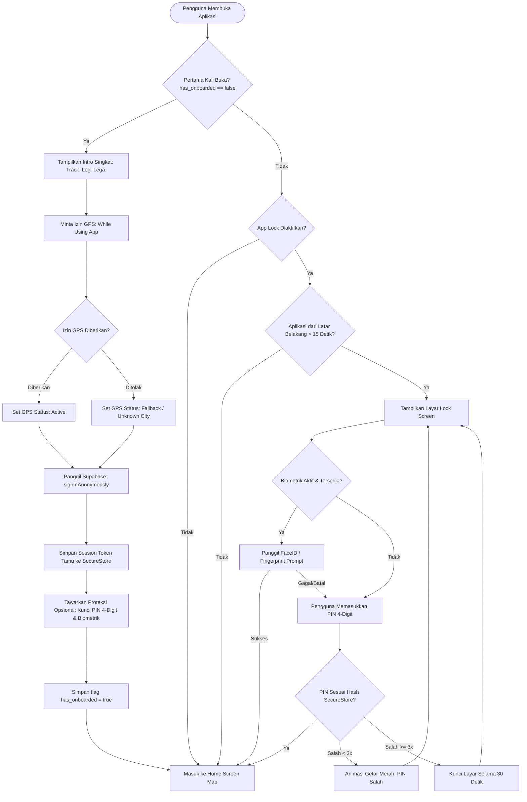
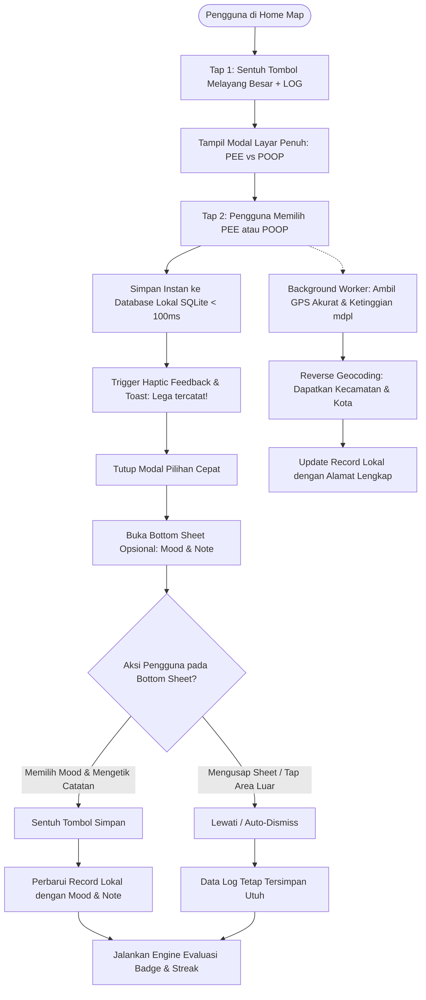
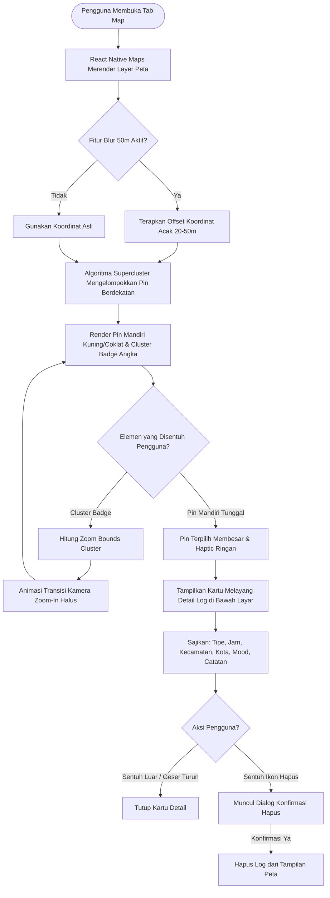
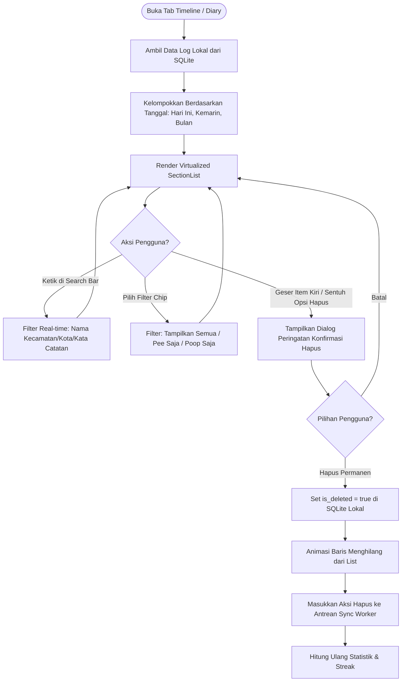
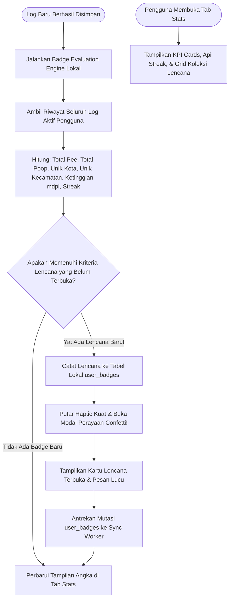
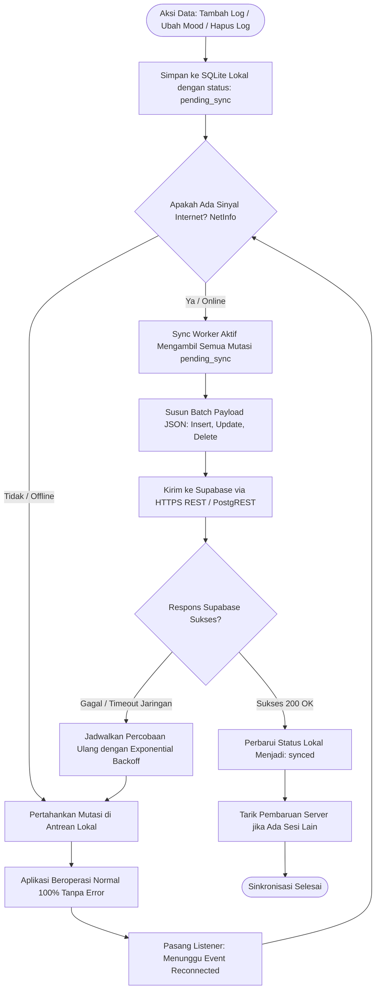

# Flowchart Sistem & Panduan Alur Kerja
# Poop Pee Log ("Track. Log. Lega.")

Dokumen ini memuat diagram alur interaktif berbasis **Mermaid** dan penjelasan teks step-by-step terperinci untuk 6 alur utama aplikasi Poop Pee Log:
1. **Flow Onboarding, Anonymous Auth & App Lock**
2. **Flow 3-Detik Log Pee/Poop (Core Engine)**
3. **Flow Lihat Detail Pin & Clustering di Peta**
4. **Flow Lihat Timeline & Hapus Log**
5. **Flow Evaluasi Statistik & Unlock Badge**
6. **Flow Offline-First Synchronization**

---

## 1. Flow Onboarding, Anonymous Auth & App Lock

Alur saat pengguna pertama kali memasang aplikasi (mode tamu tanpa hambatan) serta pengamanan saat aplikasi dibuka kembali via PIN atau Biometrik.

### 1.1 Diagram Mermaid

### 1.2 Penjelasan Langkah-demi-Langkah
1. **Cold Start & Deteksi Onboarding**: Aplikasi mengecek flag lokal `has_onboarded`.
2. **Izin GPS Tanpa Paksaan**: Jika aplikasi baru pertama kali dibuka, pengguna disajikan ringkasan nilai privasi lalu diminta izin GPS. Jika ditolak, aplikasi tetap bisa dipakai dengan menandai kota sebagai "Lokasi Tidak Diketahui".
3. **Anonymous Guest Sign-in**: Aplikasi secara otomatis memanggil `supabase.auth.signInAnonymously()`. Token sesi tamu disimpan di `expo-secure-store`. Pengguna tidak perlu mengisi email, password, ataupun OTP.
4. **Setup App Lock Opsional**: Pengguna ditawari membuat 4 digit PIN dan mengaktifkan FaceID/Fingerprint.
5. **Validasi Kunci saat Resume**: Pada sesi berikutnya, jika App Lock aktif dan jeda aplikasi berada di latar belakang lebih dari 15 detik, layar terkunci otomatis dan memerlukan otentikasi ulang.

---

## 2. Flow 3-Detik Log Pee/Poop (Core Engine)

Alur utama pencatatan berkecepatan tinggi dengan filosofi 2-tap sub-3 detik dan pengayaan data non-blocking di latar belakang.

### 2.1 Diagram Mermaid

### 2.2 Penjelasan Langkah-demi-Langkah
1. **Tap 1**: Pengguna menyentuh tombol lingkaran melayang (FAB) `+ LOG` di tengah bawah layar.
2. **Tap 2**: Pengguna menyentuh salah satu dari dua tombol besar:
   - **PEE** (Warna Kuning Emas `#F59E0B`)
   - **POOP** (Warna Coklat Kopi `#78350F`)
3. **Penyimpanan Lokal Sub-100ms**: Sistem langsung mencatat log baru dengan waktu lokal dan koordinat terakhir dari cache (*last known position*) ke database lokal SQLite.
4. **Konfirmasi Sensorik**: Getaran haptic terasa dan toast konfirmasi "Lega tercatat!" muncul seketika.
5. **Background Enrichment**: Di latar belakang, GPS akurat dan reverse geocoding kecamatan/kota dijalankan tanpa membuat aplikasi lag.
6. **Sheet Non-Blocking**: Bottom sheet mood dan catatan muncul secara opsional. Jika pengguna terburu-buru memasukkan HP ke kantong, sheet dapat dilewati tanpa membatalkan log.

---

## 3. Flow Lihat Detail Pin & Clustering di Peta

Alur interaksi pengguna saat menjelajahi peta jejak aib, memecah cluster, dan memeriksa detail log.

### 3.1 Diagram Mermaid

### 3.2 Penjelasan Langkah-demi-Langkah
1. **Rendering Peta**: Peta interaktif memuat data log dari penyimpanan lokal.
2. **Evaluasi Privasi**: Jika fitur "Blur 50m" aktif, pin digeser secara acak dalam radius 20–50 meter dari titik asli demi menjaga privasi pengguna.
3. **Supercluster**: Pin yang saling berdekatan pada level zoom rendah digabungkan menjadi satu lingkaran cluster berisi angka total log.
4. **Interaksi Cluster**: Mengetuk cluster memicu animasi kamera meluncur (*fly-to/zoom-in*) langsung memecah cluster menjadi pin-pin individu.
5. **Interaksi Pin Tunggal**: Mengetuk satu pin membuka kartu detail melayang yang memperlihatkan jam, nama kecamatan, status mood, dan catatan pribadi.

---

## 4. Flow Lihat Timeline & Hapus Log

Alur pengguna memeriksa buku harian kronologis, mencari log spesifik, dan melakukan penghapusan data secara aman.

### 4.1 Diagram Mermaid

### 4.2 Penjelasan Langkah-demi-Langkah
1. **Query & Pengelompokan**: Seluruh data log lokal dikelompokkan dengan *sticky header* tanggal (contoh: "Hari Ini - 9 Nov 2026").
2. **Pencarian Cepat**: Kolom pencarian menyaring item secara instan berdasarkan nama daerah atau isi catatan tanpa jeda loading.
3. **Konfirmasi Penghapusan**: Tombol hapus memicu dialog konfirmasi untuk menghindari ketidaksengajaan.
4. **Tombstone Soft-Delete**: Data ditandai `is_deleted = true` secara lokal agar penghapusan dapat disinkronkan ke cloud saat perangkat online kembali.

---

## 5. Flow Evaluasi Statistik & Unlock Badge

Alur kalkulasi performa biologis, pembaruan api streak, dan perayaan pembukaan lencana baru.

### 5.1 Diagram Mermaid

### 5.2 Penjelasan Langkah-demi-Langkah
1. **Pemicu Otomatis**: Setiap kali ada log baru yang tersimpan, engine evaluasi lencana langsung memeriksa riwayat data lokal.
2. **Perhitungan Metrik**: Sistem menghitung total log, akumulasi kecamatan unik, ketinggian lokasi (mdpl), dan streak harian berdasarkan zona waktu lokal.
3. **Unlock & Perayaan**: Jika kriteria tercapai (contoh: log pertama membuka badge *Pendatang Baru*, atau boker di 3 kecamatan membuka badge *Penjelajah Kota*), modal animasi confetti langsung menyapa pengguna.
4. **Sinkronisasi**: Pencapaian lencana dicatat secara lokal terlebih dahulu lalu diantrekan ke Supabase.

---

## 6. Flow Offline-First Synchronization

Alur ketahanan data saat pengguna berada di area tanpa sinyal dan proses rekonsiliasi data saat koneksi internet tersambung kembali.

### 6.1 Diagram Mermaid

### 6.2 Penjelasan Langkah-demi-Langkah
1. **Penyimpanan Lokal Pertama**: Semua operasi data selalu ditulis ke database SQLite lokal terlebih dahulu dengan tanda `pending_sync`. Aplikasi tidak pernah menunggu respons server untuk menampilkan UI.
2. **Deteksi Konektivitas**: Modul `@react-native-community/netinfo` memantau koneksi secara pasif di latar belakang.
3. **Pengiriman Batch**: Begitu koneksi internet terdeteksi, `SyncWorker` mengemas semua data yang tertunda dan mengirimkannya sekaligus ke Supabase.
4. **Resolusi Konflik Last-Write-Wins**: Jika ada perbedaan data, timestamp `client_created_at` menentukan kebenaran data terkini. Setelah berhasil, status lokal diubah menjadi `synced`.
